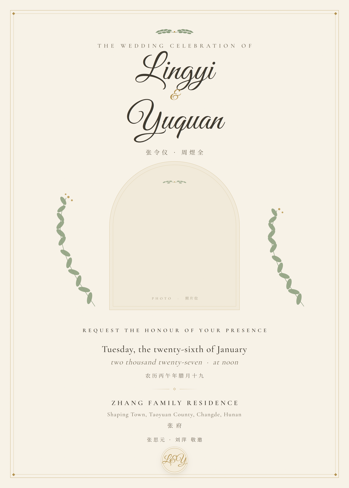

# 婚礼请柬海报 · Wedding Posters

张令仪 & 周煜全 的两套婚礼请柬海报，信息与 [York1120/wedding](https://github.com/York1120/wedding) 电子请柬一致：

- **婚期**：公历 2027年1月26日（星期二）· 农历丙午年腊月十九
- **地点**：湖南省常德市桃源县沙坪镇 · 张府
- **主婚**：张思元 · 刘萍

| 中式 · 红金 | 西式 · 象牙白 |
|---|---|
|  |  |
| 吾家有喜 · 双联红金海报 | Lingyi & Yuquan · 拱门照片位海报 |

## 文件结构

```
chinese/   中式红金海报  poster.png(2200×2000) / poster.html(自包含单文件) / poster-design.md
western/   西式象牙白海报 poster-western.png(3000×4200) / poster-western.html / poster-design-western.md
src/       渲染源码（HTML + 截图脚本 + 字体下载脚本）
```

两份 `.html` 都是**自包含单文件**：字体按用字裁剪为子集、图片 base64 内嵌，离线双击即可打开，浏览器窗口多大都会整张等比缩放显示。西式 HTML 的照片位目前留空，替换方法见文件内注释。

> 注：`chinese/poster.png` 与 `src/photo1.jpg` 含新人照片，介意公开展示的话请将本仓库设为 private。

## 修改后重新生成

环境要求：Python 3 + fontTools/brotli、Node.js + 本机 Chrome。

```bash
cd src
python fetch_fonts.py          # 1. 下载完整字体(约35MB, 字体不入库)
npm i playwright               # 2. 安装渲染依赖(走系统 Chrome)
node render.js                 # 3a. 重新渲染中式 PNG
node render_western.js         # 3b. 重新渲染西式 PNG
python build_html.py           # 4a. 重新生成中式自包含 HTML
python build_western_html.py   # 4b. 重新生成西式自包含 HTML
```

改文字直接编辑 `src/poster.html` / `src/poster_western.html`（内部为 2200×2000 / 1500×2100 画布的绝对定位排版），生成脚本会自动按新文案重新裁剪字体子集。

## 字体

全部为 SIL Open Font License，可自由分发与内嵌：

- 马善政毛笔楷书（Ma Shan Zheng）· 思源宋体（Noto Serif SC）
- Great Vibes · Cormorant Garamond
